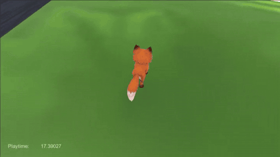
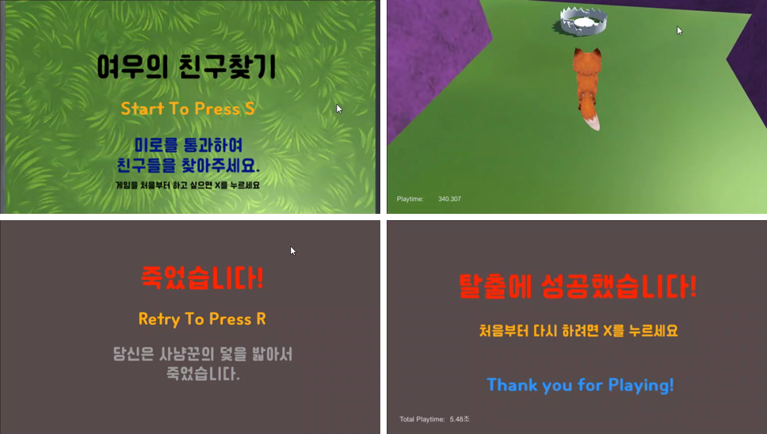
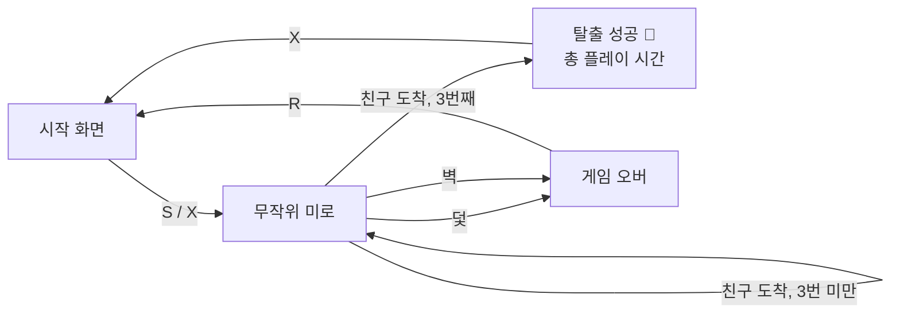

# 🦊 여우의 친구찾기 (RandomMaze)

아기 여우가 위험한 장애물과 미로를 피해 **친구들이 있는 곳으로 찾아가는** 3D 미로 게임입니다.
무작위로 나오는 미로를 3번 통과하면 성공! 벽이나 사냥꾼의 덫에 닿으면 실패예요.


<p align="center">
  
</p>

## 📸 스크린샷



## 🎬 발표자료 · 시연영상

| 자료 | 내용 |
|---|---|
| 📑 [발표자료 (PDF)](docs/presentation.pdf) | 게임 개요, 조작법, 구현한 기능, 어려웠던 점, 에셋 출처 |
| 🎥 [세 번 통과 시 승리](docs/videos/clear-3-mazes.mp4) | 미로 3개를 통과해 친구들을 찾고 탈출에 성공하는 장면 (0:30) |
| 🎥 [이동속도 조절](docs/videos/run-speed.mp4) | 걷기와 `Shift` 달리기 비교 (0:17) |
| 🎥 [죽는 방법](docs/videos/game-over.mp4) | 덫을 밟았을 때와 벽에 부딪혔을 때의 게임 오버 (0:22) |

> 영상 링크를 누른 뒤 GitHub 화면에서 바로 재생하거나 `View raw`로 내려받을 수 있습니다.

## 🎮 조작법

| 키 | 동작 |
|---|---|
| `W` `S` / `↑` `↓` | 앞으로 / 뒤로 이동 |
| `A` `D` / `←` `→` | 왼쪽 / 오른쪽 회전 |
| `Left Shift` (누르는 동안) | 달리기 (속도 2배) |
| `C` | 카메라 시점 전환 (위에서 보기 ↔ 낮은 시점) |

| 화면 | 키 | 동작 |
|---|---|---|
| 시작 | `S` | 게임 시작 (이전 플레이 시간에 이어서) |
| 시작 | `X` | 처음부터 다시 (플레이 시간 초기화) |
| 게임 오버 | `R` | 시작 화면으로 |
| 탈출 성공 | `X` | 시작 화면으로 |

## 📜 게임 규칙

- 미로는 3종류(`map1`~`map3`) 중 **무작위**로 나옵니다.
- 미로 끝에서 친구들을 만나면 다음 미로로 넘어가고, **3번 통과하면 탈출 성공**입니다.
- **사냥꾼의 덫**을 밟거나 **독성 이끼가 가득한 벽**에 부딪히면 게임 오버.
- 화면 왼쪽 아래에 플레이 시간이 표시되고, 탈출 성공 화면에서 총 기록을 보여 줍니다.



## ✨ 구현 포인트

- **시점 전환**: `smooth_follow.cs`의 카메라 높이와 거리를 바꿔 `C`키로 두 가지 시점을 오갈 수 있습니다.
- **정확하게 쌓이는 플레이 시간**: `PlayerPrefs`에 시간을 저장해서 씬이 바뀌거나 여러 번 죽어도 실제로 플레이한 시간만 누적됩니다.
- **멈추지 않는 아기 여우**: 애니메이션 전환(Has Exit Time)을 이용해 여우가 쉽게 멈추지 않도록 해서 긴장감을 높였습니다. (아기 여우는 호기심이 많아서 일단 돌아다녀야 해요.)

## 🧩 어려웠던 점과 해결 방법

- **씬 시작 직후 미끄러지는 문제**: 정지 애니메이션 상태에서 키를 누르면 여우가 미끄러지듯 움직였습니다.
  → 씬 시작 후 **2초 동안 조작을 막고**, 이 2초는 플레이 시간에서 빼도록 했습니다.
- **난이도 조절**: 처음에는 3개의 맵을 모두 한 번씩 통과해야 클리어하도록 계획했지만, 전체 난이도가 높아서
  → **무작위로 나오는 맵을 3번 통과**하면 클리어하도록 바꿨습니다.

## ▶️ 실행 방법

1. 레포지토리를 클론합니다.
   ```bash
   git clone https://github.com/startercube/RandomMaze.git
   ```
2. **Unity Hub**에서 `Add` → 클론한 폴더를 선택합니다. (에디터 버전 **2022.3.62f3** 권장)
3. `Assets/Scenes/SampleScene.unity`를 열고 ▶ Play 버튼을 누릅니다.

## 🗂️ 프로젝트 구조

```
Assets/
├── Scenes/      # SampleScene(시작), map1~3(미로), crush_wall·crush_trap(게임 오버), success(탈출 성공)
├── Scripts/     # 게임 로직 (아래 표 참고)
├── Resources/   # 여우 모델, 덫, TextMesh Pro
├── wall_prefab/ # 미로 벽 프리팹
└── ...          # 외부 에셋 (아래 '사용한 에셋' 참고)
docs/
├── presentation.pdf  # 발표자료
├── videos/           # 시연영상 3개
└── images/           # README용 GIF·스크린샷
```

| 스크립트 | 역할 |
|---|---|
| `playerctrl.cs` | 여우 이동·회전·달리기, 애니메이션, 충돌 판정(벽/덫/도착), 플레이 시간 |
| `smooth_follow.cs` | 여우를 따라가는 3인칭 카메라, `C`키 시점 전환 |
| `startgame.cs` | 시작 화면 입력 (`S` 시작 / `X` 처음부터) |
| `Retry.cs` | 게임 오버 화면에서 `R`로 다시 시작 |
| `success.cs` | 탈출 성공 화면, 총 플레이 시간 표시 |
| `audio_*.cs` | 각 씬의 배경음악 재생 |

## 🎨 사용한 에셋

| 에셋 | 용도 | 출처 |
|---|---|---|
| Cafe24 Ssurround | 폰트 | [카페24 폰트](https://fonts.cafe24.com) (SIL OFL 1.1) |
| Toon Fox | 여우 모델 | Unity Asset Store |
| Fantasy Landscape | 바닥·나무·풀 | Unity Asset Store |
| Casual Game BGM #5 | 배경음악 | Unity Asset Store |
| Footstep (Snow and Grass) | 발소리 | Unity Asset Store |
| Trap | 덫 모델 | [Free3D](https://free3d.com/ko/3d-model/trap-65059.html) |
| doorOpen_002 | 효과음 | [Kenney Sci-fi Sounds](https://kenney.nl/assets/sci-fi-sounds) |
| concrete_a02, smooth_follow.cs | 벽 재질, 카메라 스크립트 | 수업 자료 |

## 📄 라이선스

이 프로젝트의 **코드**는 [MIT License](LICENSE)를 따릅니다.
위의 외부 에셋은 각 제작자의 라이선스를 따르며 MIT 라이선스에 포함되지 않습니다.
